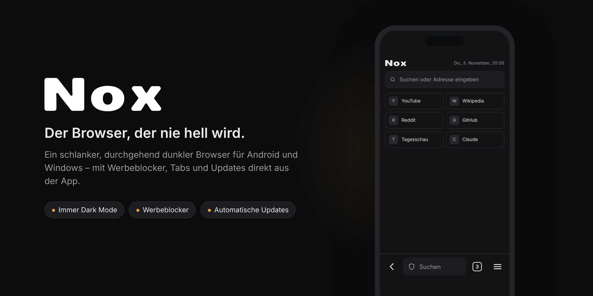

  

  
  &nbsp;
  

  Android 8.0 oder neuer · Windows 10 und 11 · kostenlos · ohne Konto · ohne Tracking

---

**Nox** ist ein schlanker Browser für **Android und Windows**, der von der ersten bis zur letzten Sekunde dunkel bleibt. Kein weißes Aufblitzen beim Start, keine grellen Menüs, und Websites ohne eigenen Dark Mode werden auf Wunsch automatisch abgedunkelt.

## ✦ Funktionen

| | |
|---|---|
| 🌙 **Immer dunkel** | Oberfläche, Startseite, Fehlerseiten und Menüs sind komplett dunkel – auch wenn dein Gerät im hellen Modus ist. |
| 🌗 **Websites abdunkeln** | Seiten ohne eigenen Dark Mode werden automatisch dunkel dargestellt (Windows, und auf Android ab Version 13). |
| 🛡️ **Werbeblocker** | Blockiert Werbung und Tracker schon beim Laden. Das Schild in der Suchleiste zeigt, wie viel es auf der aktuellen Seite war. |
| 🗂️ **Tabs** | Beliebig viele Tabs mit übersichtlicher Tab-Ansicht. Beim nächsten Start ist alles wieder da. |
| 🔎 **Deine Suchmaschine** | DuckDuckGo, Brave, Ecosia oder Google – mit einem Tipp im Menü umgestellt. |
| ⬇️ **Downloads & mehr** | Dateien herunterladen, Dateien hochladen, Videos im Vollbild, Links teilen. |
| 🔄 **Updates aus der App** | Nox schaut selbst nach neuen Versionen und installiert sie – ohne Store, ohne Neuinstallation. |

**Nur unter Windows:** Claude als Seitenleiste, Chrome-Erweiterungen (entpackt), eigene CSS- und JavaScript-Dateien pro Website und praktische Tastenkürzel wie `Strg+T`, `Strg+W` und `Strg+L`.

## 📲 Installieren

**Android**

1. Tippe oben auf **„Für Android laden“** – am besten direkt auf deinem Handy.
2. Öffne die heruntergeladene Datei `Nachtfalter.apk`.
3. Android fragt beim ersten Mal, ob dein Browser **Apps aus unbekannten Quellen** installieren darf. Erlaube das einmal.
4. Auf **Installieren** tippen – fertig. Nox findet sich danach in deiner App-Liste.

> **Tipp:** Unter *Einstellungen → Apps → Standard-Apps → Browser* kannst du Nox als Standardbrowser festlegen. Dann öffnen sich Links aus anderen Apps direkt in Nox.

**Windows**

1. Klicke oben auf **„Für Windows laden“** und lade beim neuesten Release die Datei `Nox-Setup-X.Y.Z.exe` herunter.
2. Starte die Datei. Weil Nox (noch) nicht mit einem kostenpflichtigen Zertifikat signiert ist, zeigt Windows eventuell **„Der Computer wurde durch Windows geschützt“**. Dann auf **Weitere Informationen → Trotzdem ausführen** klicken.
3. Nox installiert sich von selbst und legt eine Verknüpfung auf dem Desktop und im Startmenü an.

## 🔄 Updates

Du musst Nox nur **ein einziges Mal** installieren. Danach meldet sich die App von selbst, sobald es eine neue Version gibt – einmal bestätigen, und das Update wird geladen und installiert. Von Hand geht's auf beiden Geräten über **☰ → Nach Updates suchen**.

Was sich in jeder Version geändert hat, steht in der [Versionsgeschichte](https://github.com/noah1o7/Nox-Browser/commits/main).

## 🔒 Datenschutz

- Kein Konto, keine Anmeldung, keine Werbung.
- Nox sammelt **keine** Daten und schickt nichts an mich oder Dritte.
- Von sich aus verbindet sich Nox nur mit GitHub (Update-Check) und unter Windows zusätzlich mit dem Server des Werbeblockers, um die aktuellen Filterlisten zu laden.

## 🎨 Gestaltung

Flache Flächen in Graphit (`#131416`, `#1b1c1f`), feine Linien (`#2f3034`) und genau eine Akzentfarbe: Bernstein (`#e8a33d`). Der Akzent markiert nur Fokus, Fortschritt und die wichtigste Aktion. Übergänge sind kurze, ruhige Überblendungen.

---

<b>🛠️ Für Entwickler: selbst bauen & neue Version veröffentlichen</b>

 

**Aufbau**

| Ordner | Inhalt |
|---|---|
| `app/` | Android-App in **Kotlin** auf Basis von Android-WebView (öffnen mit Android Studio) |
| `windows/` | Windows-App mit **Electron** (Chromium), Werbeblocker von Ghostery |
| `updates/` | Aktuelle Android-APK und `version.json` für den Update-Check |

**Neue Android-Version**

1. `versionCode` und `versionName` in `app/build.gradle.kts` hochzählen
2. `./gradlew assembleRelease` ausführen (signiert mit dem Nox-Schlüssel, der **nicht** in diesem Repo liegt)
3. APK als `updates/Nachtfalter.apk` ablegen und in `updates/version.json` die neue Version eintragen – die App findet das Update von selbst

**Neue Windows-Version**

1. `version` in `windows/package.json` hochzählen
2. Im Ordner `windows`: `npm install` und `npm run dist`
3. Ein GitHub-Release anlegen und `windows/fertig/Nox-Setup-X.Y.Z.exe` anhängen – Nox findet das Update von selbst. Am besten auch die aktuelle APK als `Nox-X.Y.Z.apk` dazulegen.

Die interne App-Kennung bleibt auf beiden Plattformen `de.noah.nachtfalter`, damit Updates über bestehende Installationen funktionieren.

Gebaut von <a href="https://github.com/noah1o7">noah1o7</a> 🌙

